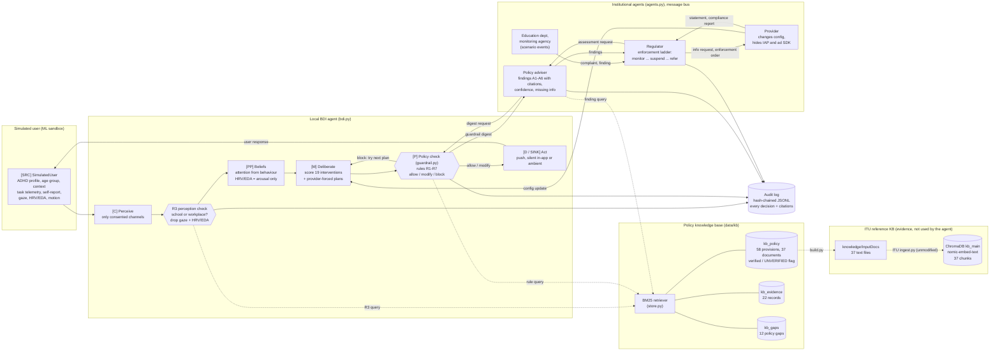

# Pipeline (ITU-T Y.3172 view)

How one tick of the simulation flows through the system, and where the policy knowledge base comes in.
Node labels in brackets are the Y.3172 pipeline nodes; see [mapping.md](mapping.md) for the full mapping.

## Reading it

- **Left to right is one tick.** The user produces signals; the agent perceives only consented channels. In a school
  or workplace, the R3 check drops gaze and HRV/EDA before they become beliefs. The agent picks an intervention, the
  policy check allows, changes or blocks it, and the user responds.
- **Dotted lines are retrieval.** The policy check, the R3 check and the adviser query the knowledge base to fetch the
  provisions they cite. Rules decide; retrieval supplies the legal basis and flags a rule whose sources are missing.
- **The bottom half is the error scenario.** The provider changes the app, outside bodies report problems to the
  regulator, the adviser assesses with the facts it has so far, and the regulator acts. The agent's guardrail digest
  is how the adviser learns what the provider tried.
- **Everything that decides something writes to the audit log**, so the run can be replayed and checked.
- **The ITU box is separate.** It is the same policy content ingested with ITU's reference pipeline, kept as evidence
  and as a deliverable. The agent does not query it.
